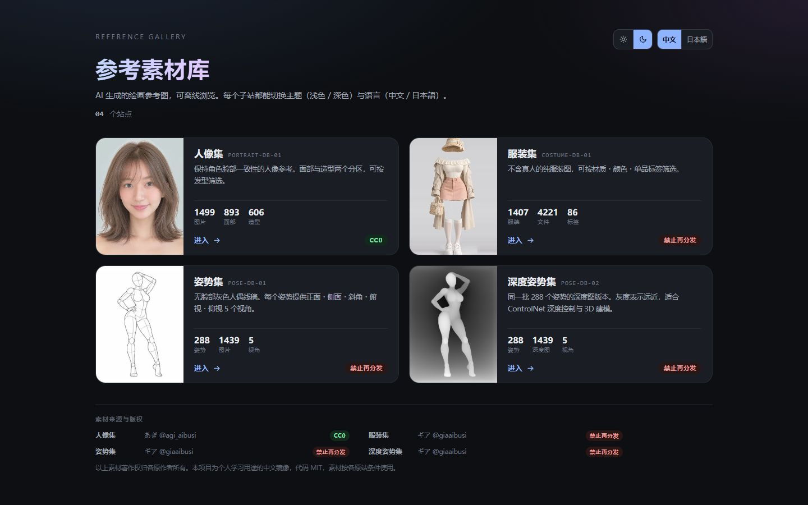
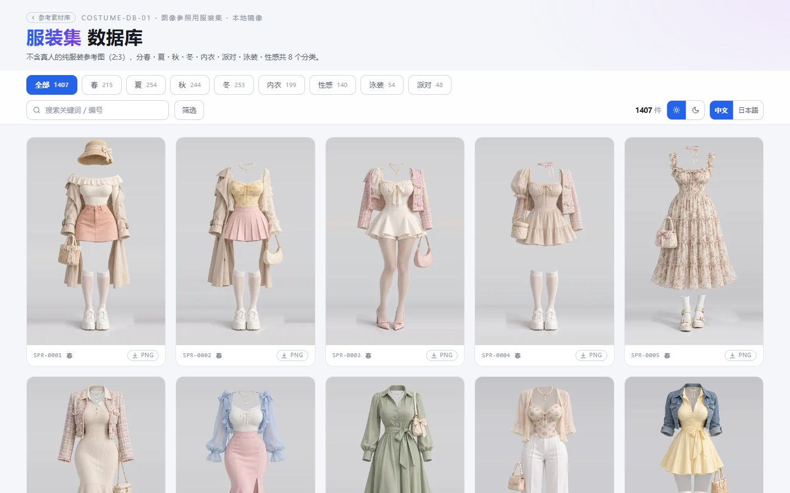

<div align="center">

# AI 图片素材库 · 单仓多站

**四个 AI 绘画参考图库，一个仓库构建，一个目录部署**

人像 · 姿势 · 深度姿势 · 服装 · 12,975 张参考图 · 中日双语 · 浅色 / 深色

[](https://photoai.life/)
[](#-四个站点)
[](#-四个站点)
[](#-环境要求)
[](#-授权)

### [在线浏览 · photoai.life →](https://photoai.life/)

[中文](#中文) · [English](#english) · [日本語](#日本語)

</div>

---

# 中文

## 📖 项目简介

四个面向 AI 绘画的参考图库，原先分散在四个独立仓库，每个仓库都复制了同一套页面模板。
现在合并成一个仓库：**一份代码、一份构建脚本、一个发布目录**。

四个站都挂在同一个域名下，打开 [photoai.life](https://photoai.life/) 即可浏览，不需要下载 6.8 GB 素材，也不需要自己部署。

### ✨ 核心特性

- 🖼️ **四个图库**：人像 1,499 张、姿势 1,439 张、深度姿势 1,439 张、服装 1,407 件（4,221 张）
- ⚡ **点开即看**：网格只加载缩略图；灯箱先显示清晰缩略图，再换成约 100 KB 的中图；鼠标悬停时就开始预取
- 🔎 **筛选与搜索**：人像按发型，姿势按系列 / 分类 / 视角，服装按 86 个标签分面筛选
- 🌗 **双主题**：浅色 / 深色，记住上次选择，刷新不闪白
- 🌐 **双语**：中文 / 日本語 实时切换
- 📦 **零前端依赖**：单个 `index.html`，数据内嵌，无框架、无 CDN、无外部字体
- 🔗 **硬链接发布**：17,352 个图片文件硬链接进 `dist/`，不额外占盘
- ➕ **加站简单**：建一个目录、往 `sites.json` 追加一条记录

---

## 📸 页面预览

### 🏠 入口页


- 四个子站的卡片，封面取自各站素材，右下角标出授权（只有人像集是 CC0）
- 右上角切换主题和语言，偏好保存在本地
- 页脚列出每个站的原作者与原站链接

<details>
<summary>深色主题</summary>



</details>

### 👤 人像集


- 「面部」893 张、「造型」606 张两个分区，可按发型筛选
- 每张卡片带 PNG 下载按钮，鼠标停留时显示原图体积
- 滚到底部自动加载下一页，每页 60 张


- 点开后立即显示清晰缩略图，中图（约 115 KB）到达后淡入
- `←` `→` 翻页，`Esc` 关闭；可下载原图、打开原寸 PNG、复制图片链接

### 🧍 姿势集


- 288 个姿势，每个姿势有正面、横、斜、俯、仰 5 个视角
- 卡片下方的视角条悬停即可切换缩略图，点击直接打开对应视角
- 可按系列、分类、视角筛选，按编号或名称搜索


- 右侧列出系列、分类、编号、视角；点击小图切换视角
- `←` `→` 切视角，`↑` `↓` 换姿势，手机上可左右滑动
- 打开后会预取同一姿势的其余视角，切换时不用再等

### 🌫️ 深度姿势集


- 同一批 288 个姿势的灰度深度图，适合 ControlNet depth 控制和 3D 建模参考
- 界面和姿势集一致，两个站共用同一个生成器

### 👗 服装集




- 8 个分类，86 个标签分成颜色、单品、鞋袜、配饰、材质图案、长度 6 组
- 标签多选为「且」的关系，每个标签旁显示命中数量
- 搜索框同时匹配中文、日文和英文原文


- 点击右侧标签可直接追加到筛选条件
- 英文原文标签可复制，直接用作 AI 出图的提示词

---

## 🗂️ 四个站点

| 站点 | 内容 | 规模 | 授权 | 单独仓库 |
|---|---|---|:---:|---|
| [人像集](https://photoai.life/portrait/) | 保持角色脸部一致性的人脸参考 | 1,499 张 | **CC0** | [ai-portrait-gallery-cn](https://github.com/Brilliant666/ai-portrait-gallery-cn) |
| [姿势集](https://photoai.life/pose/) | 无脸灰色人偶线稿，每个姿势 5 个视角 | 1,439 张 | 禁止再分发 | [ai-pose-gallery-cn](https://github.com/Brilliant666/ai-pose-gallery-cn) |
| [深度姿势集](https://photoai.life/pose-depth/) | 同批姿势的灰度深度图 | 1,439 张 | 禁止再分发 | [ai-pose-depth-gallery-cn](https://github.com/Brilliant666/ai-pose-depth-gallery-cn) |
| [服装集](https://photoai.life/costume/) | 不含真人的服装图，标签分面筛选 | 1,407 件 / 4,221 张 | 禁止再分发 | [ai-costume-gallery-cn](https://github.com/Brilliant666/ai-costume-gallery-cn) |

> ⚠️ **四个站里只有人像集是 CC0**，其余三个禁止再分发图片数据。详见各站 `sites/<id>/NOTICE.md`。

---

## ⚡ 图片加载

每张图有三档。网格只用缩略图，灯箱用中图，原图只在下载时用到。

| 档位 | 用途 | 人像 | 姿势 | 深度姿势 | 服装 |
|---|---|---:|---:|---:|---:|
| 缩略图 | 网格、灯箱底图 | 约 20 KB | 约 17 KB | 约 11 KB | 约 10 KB |
| 中图 | 灯箱 | 约 150 KB | 约 33 KB | 约 10 KB | 约 90 KB |
| 原图 | 下载 | 约 3.2 MB | 约 450 KB | 约 95 KB | 约 1 MB |

- 服装集的中图来自原站；另外三站的中图由 `tools/mid.py` 从原图生成（最长边 1600px，WebP 质量 82）
- 灯箱打开时先显示**清晰的**缩略图，中图到达后淡入覆盖；换图时上一张立即隐藏，不会残留
- 鼠标在卡片上停留 120 ms、手指按下或键盘选中时开始预取中图；打开后预取前后各一张
- 中图缺失时自动退回原图，所以漏跑 `mid.py` 不会坏，只是慢

在 1.5 MB/s、150 ms 延迟下实测人像集：直接点击约 0.6 秒换成中图；悬停约 1 秒后再点，打开即为中图。

---

## 🛠️ 技术取舍

**图片不进 git。** 6.8 GB 二进制素材放进仓库，每次 clone 都要拉一遍，各站授权也不允许。`tools/fetch.py` 幂等下载：首次部署拉一次，之后只补缺失文件。

**发布用硬链接。** `tools/release.py` 把图片硬链接进 `dist/`。同一文件系统下，`dist/` 显示 7.0 GB，实际不额外占盘。

**页面零依赖。** 单个 `index.html`，数据内嵌，没有框架、CDN 和外部字体，`file://` 双击也能看。构建脚本只用 Python 标准库，唯一例外是生成中图的 `tools/mid.py`，需要 Pillow。

**同结构站点共用生成器。** 姿势集和深度姿势集原来是两份各 860 行、98.8% 相同的脚本，现在共用 `shared/pose_gallery.py`，各站只留文案配置。

| | 合并前 | 合并后 |
|---|---:|---:|
| 仓库数 | 4 | **1** |
| 加一个站 | 复制 860 行脚本再改 | **建目录 + 加一条 JSON** |
| 部署 | 4 套 nginx / 4 个目录 | **1 个 `dist/`，按路径区分** |

---

## 📁 项目结构

```
ai-image-gallery/
├── sites.json              # 唯一清单：站点、顺序、授权、图片档位
├── sites/                  # 各站点：脚本 + 数据 + 构建产物
│   ├── portrait/
│   ├── pose/               #   config.py 只放文案，页面由 shared/ 生成
│   ├── pose-depth/
│   └── costume/
├── shared/
│   ├── pose_gallery.py     # 姿势 / 深度姿势共用的页面生成器
│   └── pose_i18n.py        # 系列、分类、视角、姿势名的日中对照
├── hub/
│   ├── build_hub.py        # 入口页生成器（同时生成根 sitemap / robots）
│   └── index.html          # 生成物
├── tools/
│   ├── fetch.py            # 下载图片（幂等）
│   ├── mid.py              # 从原图生成灯箱中图（幂等，需要 Pillow）
│   ├── build.py            # 构建全部站点 + 入口页
│   ├── release.py          # 组装 dist/，图片硬链接
│   └── serve.py            # 本地 HTTP 预览
├── deploy/
│   ├── DEPLOY.md           # 部署手册
│   └── nginx.conf          # nginx 模板
├── docs/screenshots/       # README 截图
└── dist/                   # 发布产物（gitignored）
```

---

## ⚙️ 环境要求

| 项 | 要求 |
|---|---|
| Python | 3.8+ |
| Pillow | 仅 `tools/mid.py` 需要：`pip install pillow` 或 `apt install python3-pil` |
| 磁盘 | 全部素材约 6.8 GB，中图约 290 MB；只下缩略图约 90 MB |
| 文件系统 | `dist/` 与 `sites/` 在同一文件系统，硬链接才生效 |

---

## 🚀 快速开始

```bash
git clone https://github.com/Brilliant666/ai-image-gallery.git
cd ai-image-gallery

python tools/fetch.py        # 1️⃣ 下载全部图片（首次，约 6.8 GB）
python tools/mid.py          # 2️⃣ 生成灯箱中图（约 290 MB）
python tools/build.py        # 3️⃣ 构建四个站 + 入口页
python tools/release.py      # 4️⃣ 组装 dist/
python tools/serve.py        # 5️⃣ 本地预览 http://127.0.0.1:8080/
```

> 💡 **验收请用 `serve.py`，不要直接双击 `dist/index.html`。** `file://` 与 `http://` 在相对路径、Content-Type、缓存上都有差异，只有 HTTP 下的表现才和线上一致。

### 🧰 常用命令

| 命令 | 作用 |
|---|---|
| `python tools/fetch.py --site pose` | 只下载姿势集 |
| `python tools/fetch.py --tier thumb` | 只下载缩略图（约 90 MB，够浏览） |
| `python tools/mid.py --site portrait` | 只生成人像集中图 |
| `python tools/build.py --site pose` | 只重建一个站 |
| `python tools/build.py --base https://x.com` | 指定正式域名，写入 canonical / og / sitemap |
| `python tools/release.py --out <目录>` | 发布到指定目录（线上更新先发到暂存目录） |
| `python tools/serve.py --root sites/pose` | 预览单个站点 |

> ⚠️ `release.py` 会先删除再重建目标站点目录。`--no-images` 只放站点文件、不放图片，**不能**用来「保留线上旧图」。

---

## ➕ 加第 N 个站

### 1️⃣ 建目录，遵守站点契约

```
sites/<新站id>/
├── scripts/
│   ├── build_gallery.py    # 必填
│   ├── download.py         # 必填
│   └── verify.py           # 建议
├── data/                   # 结构化数据（入库）
├── index.html              # 构建产物（入库，便于直接预览）
├── LICENSE
├── NOTICE.md               # 该站单独的授权说明
└── README.md
```

`tools/` 只靠下面三条约定驱动所有站点：

| 脚本 | 约定 |
|---|---|
| `scripts/build_gallery.py` | 读环境变量 `SITE_URL`，输出 `index.html`、`data/`、`robots.txt`、`sitemap.xml`、`404.html`。站点根用 `dirname(dirname(__file__))` 自己算，不依赖当前目录 |
| `scripts/download.py <tier> [workers]` | 幂等下载：已存在且大于 1 KB 的文件跳过；失败时 `sys.exit(1)` |
| `scripts/verify.py` | 校验完整性，失败时 `sys.exit(1)` |

结构和姿势集相同的站，直接复用 `shared/pose_gallery.py`，只写一份 `config.py`。

### 2️⃣ 在 `sites.json` 追加一条

```json
{
  "id": "new-site",
  "code": "NEW-DB-01",
  "name": { "zh": "新站名", "ja": "新サイト名" },
  "desc": { "zh": "一句话说明。", "ja": "一文で説明。" },
  "stats": [{ "v": "1234", "l": { "zh": "图片", "ja": "画像" } }],
  "license": "cc0",
  "source": "https://new-site.pages.dev/",
  "cover": "thumbs/cover.webp",
  "coverPos": "center 30%",
  "tiers": ["thumb", "full"],
  "imageDirs": ["thumbs", "mid", "img"]
}
```

| 字段 | 说明 |
|---|---|
| `id` | 唯一标识，同时是目录名和 URL 路径 |
| `cover` | 相对站点目录的封面路径 |
| `coverPos` | 封面框是 16:10，竖图必然裁切：脸部特写用 `25%`–`35%`，全身图用 `0%`–`10%` |
| `tiers` | 下载档位，对应 `download.py` 的参数 |
| `imageDirs` | `release.py` 硬链接的目录；含 `mid` 时 `mid.py` 会为该站生成中图 |
| `license` | `cc0` / `conditional` / `restricted` |

### 3️⃣ 构建

```bash
python tools/fetch.py --site new-site
python tools/build.py
python tools/release.py
```

站点顺序 = `sites.json` 数组顺序。

---

## 📦 部署

完整步骤见 [deploy/DEPLOY.md](deploy/DEPLOY.md)，下面是要点。

```bash
# 首次
git clone https://github.com/Brilliant666/ai-image-gallery.git /srv/ai-image-gallery
cd /srv/ai-image-gallery
apt install -y python3-pil
python3 tools/fetch.py && python3 tools/mid.py
python3 tools/build.py --base https://你的域名
python3 tools/release.py
```

```bash
# 更新：构建产物会让工作区变脏，不要用 git pull
git fetch origin && git reset --hard origin/main
python3 tools/mid.py                                   # 只补新增的中图
python3 tools/build.py --base https://你的域名
python3 tools/release.py --out dist-stage              # 先发到暂存目录，检查后再换入 dist
```

nginx 站点根指向 `dist/`。`dist/` 是扁平结构（`index.html` + `portrait/` + `pose/` + …），入口页的相对链接直接命中，不需要 `alias`。

---

## 📝 更新日志

**2026-10-30**

- ⚡ 灯箱底图去掉模糊；悬停 / 按下时预取中图；换图时上一张立即隐藏，不再残留
- ⚡ 人像、姿势、深度姿势的灯箱改加载 WebP 中图（人像从约 3 MB 降到约 115 KB），新增 `tools/mid.py`
- 🐛 修复姿势集、深度姿势集分页按钮与筛选区 `id` 重复，分页停在 60 组
- 🔍 入口页允许收录，补齐社交分享卡片和根级 sitemap / robots
- 🚀 部署到 `photoai.life`，单域名按路径区分四个站
- 🏗️ 四个独立仓库合并为单仓多站，姿势 / 深度姿势共用生成器

---

## 📄 授权

| 层级 | 范围 | 许可 |
|---|---|---|
| 代码 | `tools/`、`hub/`、`shared/`、各站 `scripts/` 与 `index.html` 内的 HTML/CSS/JS | MIT |
| 素材 | 各站图片 | **各不相同**，见 `sites/<id>/NOTICE.md` |
| 译文 | `data/` 中的中文翻译 | CC BY 4.0 |

`docs/screenshots/` 里是线上页面的界面截图，用于说明功能。截图里出现的素材著作权归各原作者所有，授权条件同上，不能从截图中提取素材另作他用。

---

## 🎨 设计约定

新增站点时请保持一致：

- 主题切换 `[☀ Light][☾ Dark]`，**默认浅色**
- 语言切换 `[中文][日本語]`，**默认中文，中文在左**
- `<head>` 内用同步脚本应用已存偏好，避免刷新闪白
- 单文件 `index.html`，数据内嵌，零外部依赖
- 分页加 `IntersectionObserver` 预取，不一次渲染全部卡片
- 灯箱底图用清晰缩略图，不加模糊

---

# English

**Four AI art reference galleries built from one repo and served from one directory.**
Browse them at [photoai.life](https://photoai.life/).

## Sites

| Site | Content | Size | License |
|---|---|---|:---:|
| [Portrait](https://photoai.life/portrait/) | Face references for character consistency | 1,499 | **CC0** |
| [Pose](https://photoai.life/pose/) | Faceless mannequin line art, 5 angles per pose | 1,439 | No redistribution |
| [Pose Depth](https://photoai.life/pose-depth/) | Grayscale depth maps of the same poses | 1,439 | No redistribution |
| [Costume](https://photoai.life/costume/) | Outfits without models, 86 faceted tags | 1,407 items / 4,221 files | No redistribution |

## Screenshots


## Quick start

```bash
git clone https://github.com/Brilliant666/ai-image-gallery.git
cd ai-image-gallery
python tools/fetch.py      # download images (~6.8 GB, idempotent)
python tools/mid.py        # generate lightbox WebP previews (needs Pillow)
python tools/build.py      # build all sites and the hub
python tools/release.py    # assemble dist/ with hard links
python tools/serve.py      # preview at http://127.0.0.1:8080/
```

## Notes

- Images are not in git. `fetch.py` downloads them once; `release.py` hard-links them into `dist/`.
- The grid loads thumbnails only. The lightbox shows the sharp thumbnail first, then fades in a ~100 KB preview, and prefetches on hover.
- Deployment steps: [deploy/DEPLOY.md](deploy/DEPLOY.md) (Chinese).
- Code is MIT. Image licenses differ per site; only Portrait is CC0. See `sites/<id>/NOTICE.md`.

---

# 日本語

**AI イラスト向けの参照画像ギャラリー 4 つを、1 つのリポジトリでビルドし、1 つのディレクトリで公開します。**
[photoai.life](https://photoai.life/) で閲覧できます。

## サイト

| サイト | 内容 | 規模 | ライセンス |
|---|---|---|:---:|
| [ポートレート集](https://photoai.life/portrait/) | キャラクターの顔の一貫性のための参考 | 1,499 | **CC0** |
| [ポーズ集](https://photoai.life/pose/) | 顔なしマネキンの線画、1 ポーズ 5 アングル | 1,439 | 再配布禁止 |
| [デプス ポーズ集](https://photoai.life/pose-depth/) | 同じポーズの深度マップ | 1,439 | 再配布禁止 |
| [衣装集](https://photoai.life/costume/) | 人物なしの衣装、86 タグで絞り込み | 1,407 着 / 4,221 枚 | 再配布禁止 |

## スクリーンショット


## クイックスタート

```bash
git clone https://github.com/Brilliant666/ai-image-gallery.git
cd ai-image-gallery
python tools/fetch.py      # 画像をダウンロード（約 6.8 GB、冪等）
python tools/mid.py        # ライトボックス用の中サイズ WebP を生成（Pillow が必要）
python tools/build.py      # 全サイトとトップをビルド
python tools/release.py    # dist/ を組み立て（画像はハードリンク）
python tools/serve.py      # http://127.0.0.1:8080/ でプレビュー
```

コードは MIT。画像のライセンスはサイトごとに異なり、CC0 はポートレート集のみです。詳しくは `sites/<id>/NOTICE.md` を参照してください。
