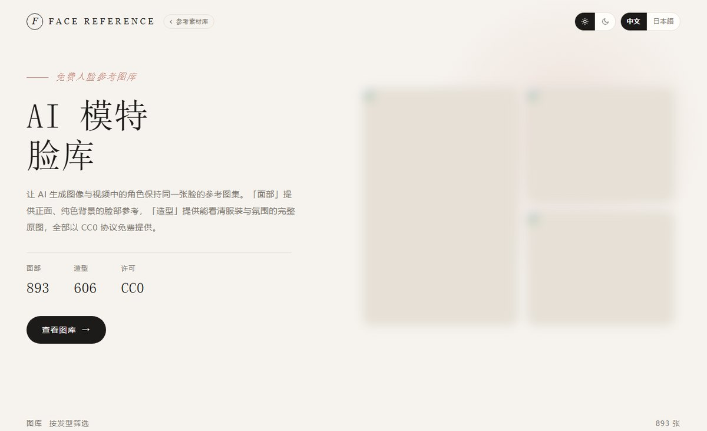

<div align="center">

# AI 图片素材库 · 单仓多站

**四个 AI 绘画参考图库 · 12,975 张图 · 一个仓库构建，一个目录部署**

[](https://photoai.life/)
[](#四个站点)
[](#四个站点)
[](#)
[](#)
[](#授权)

[四个站点](#四个站点) · [快速开始](#快速开始) · [加第 N 个站](#加第-n-个站) · [部署](#部署) · [授权](#授权)

</div>


<div align="center">

### [在线浏览 · photoai.life →](https://photoai.life/)

四个图库都在同一个域名下 —— `https://photoai.life/`
打开即用，不需要下载 6.8 GB 素材，也不需要部署

</div>

---

## 这是什么

四个面向 AI 绘画的参考图库——人像、姿势、深度姿势、服装——原先分散在四个独立仓库，
每个仓库复制了同一套页面模板。现在合并成一个仓库：**一份代码、一份构建脚本、一个发布目录**。

合并后代码从 4 份共 3,400 行降到 1,100 行，新增第 5 个站只需要建一个目录、往 `sites.json` 追加一条记录。

| | 合并前 | 合并后 |
|---|---:|---:|
| 仓库数 | 4 | **1** |
| 生成脚本 | 3,400 行（98.8% 重复） | **1,100 行** |
| 加一个站 | 复制 860 行脚本再改 | **建目录 + 加一条 JSON** |
| 部署 | 4 套 nginx / 4 个目录 | **1 个 `dist/`，路径区分** |

## 四个站点

| 站点 | 内容 | 规模 | 授权 | 单独仓库 |
|---|---|---|---:|---|
| [人像集](https://photoai.life/portrait/) | 保持角色脸部一致性的人脸参考 | 1499 张 | **CC0** | [ai-portrait-gallery-cn](https://github.com/Brilliant666/ai-portrait-gallery-cn) |
| [姿势集](https://photoai.life/pose/) | 无脸部灰色人体线稿，每姿势 5 视角 | 1439 张 | 禁止再分发 | [ai-pose-gallery-cn](https://github.com/Brilliant666/ai-pose-gallery-cn) |
| [深度姿势集](https://photoai.life/pose-depth/) | 同批姿势的灰度深度图，适合 ControlNet | 1439 张 | 禁止再分发 | [ai-pose-depth-gallery-cn](https://github.com/Brilliant666/ai-pose-depth-gallery-cn) |
| [服装集](https://photoai.life/costume/) | 8 分类 / 86 标签分面筛选 | 1407 件 4221 张 | 禁止再分发 | [ai-costume-gallery-cn](https://github.com/Brilliant666/ai-costume-gallery-cn) |

> **四个站里只有人像集是 CC0**，其余三个禁止再分发图片数据。入口页卡片右下角的徽章标出了区别。



## 技术上的几个取舍

**图片不进 git。** 6.8 GB 二进制素材放仓库里，clone 一次就是灾难。`tools/fetch.py` 幂等下载——
首次部署拉一次，之后只补缺失文件，不会重复访问原站。

**发布用硬链接。** `tools/release.py` 把图片硬链接进 `dist/`，同文件系统下零额外占盘
（实测 12,975 个文件全部硬链接，`dist/` 报告 6.8 GB 但磁盘增量接近 0）。

**零依赖。** 无框架、无 CDN、无外部字体，单个 `index.html` 数据内嵌，`file://` 双击就能看。
构建脚本只用 Python 标准库。唯一例外是生成中图的 `tools/mid.py`，需要 Pillow。

**三档图片。** 缩略图 7–18 KB / 中图 10–200 KB / 原图 0.1–6 MB。
服装集的中图来自原站；人像、姿势、深度姿势三站的中图由 `tools/mid.py` 从原图生成（最长边 1600px，WebP q82）。
网格只加载缩略图，首屏约 10 MB；灯箱才拉原图，且用双层模糊淡入避免闪烁。

---

## 目录结构

```
ai-image-gallery/
├── sites.json              ← 唯一清单：站点、顺序、授权、构建配置
├── sites/                  ← 各站点（脚本 + 数据 + 构建产物）
│   ├── portrait/
│   ├── pose/
│   ├── pose-depth/
│   └── costume/
├── shared/                 ← 多站共用的生成器
│   ├── pose_gallery.py     ← 姿势 / 深度姿势共用的页面生成器
│   └── pose_i18n.py        ← 两站共用的日→中词典
├── hub/                    ← 入口页生成器
│   ├── build_hub.py
│   └── index.html          ← 生成物
├── tools/                  ← 统一工具
│   ├── _common.py
│   ├── fetch.py            ← 下载图片
│   ├── mid.py              ← 从原图生成灯箱中图
│   ├── build.py            ← 构建页面
│   ├── release.py          ← 组装发布目录
│   └── serve.py            ← 本地 HTTP 预览
├── deploy/                 ← nginx 配置与部署手册
└── dist/                   ← 发布产物（gitignored）
```

---

## 快速开始

```bash
git clone https://github.com/Brilliant666/ai-image-gallery.git
cd ai-image-gallery

python tools/fetch.py            # 下载全部图片（首次，约 6.8 GB）
python tools/mid.py              # 生成灯箱中图（需要 Pillow，约 290 MB）
python tools/build.py            # 构建四个站 + 入口页
python tools/release.py          # 组装 dist/（图片用硬链接，不额外占盘）

# 用 HTTP 服务预览 dist/ —— 这才是 nginx 将要服务的形态
python tools/serve.py            # http://127.0.0.1:8080/
```

> **验收请用 `serve.py`，不要直接双击 `dist/index.html`。**
> `file://` 与 `http://` 在相对路径、Content-Type、缓存行为上都有差异，
> 只有 HTTP 服务下的表现才和线上一致。

### 命令一览

| 命令 | 作用 |
|---|---|
| `python tools/fetch.py` | 下载全部站点图片，已存在自动跳过 |
| `python tools/fetch.py --site pose` | 只下载姿势集 |
| `python tools/fetch.py --tier thumb` | 只下载缩略图（约 90 MB，够浏览） |
| `python tools/mid.py` | 生成人像 / 姿势 / 深度姿势的灯箱中图，已生成的跳过 |
| `python tools/build.py` | 构建全部站点 + 入口页 |
| `python tools/build.py --site pose` | 只重建一个站（快） |
| `python tools/build.py --base https://x.com` | 指定正式域名，写入 canonical / og / sitemap |
| `python tools/release.py` | 生成 `dist/`，图片硬链接 |
| `python tools/release.py --no-images` | 只放站点文件，图片沿用服务器上的旧版 |
| `python tools/serve.py` | 本地 HTTP 预览 `dist/`，自动选空闲端口 |
| `python tools/serve.py --root sites/pose` | 预览单个站点 |

---

## 站点复用

结构相同的站点不复制代码，而是抽到 `shared/`，各站只留配置。

| 站点 | 生成逻辑 | 品牌配置 |
|---|---|---|
| 姿势集 | `shared/pose_gallery.py` | `sites/pose/config.py` |
| 深度姿势集 | 同上 | `sites/pose-depth/config.py` |
| 服装集 | 自己的 `scripts/build_gallery.py` | — |
| 人像集 | 自己的 `scripts/build_gallery.py` | — |

姿势集与深度姿势集结构完全一致，只差品牌文案与图源：

```
shared/pose_gallery.py    861 行   页面模板 + CSS + JS
shared/pose_i18n.py       337 行   系列/分类/视角/姿势名 日中对照
sites/pose/config.py       94 行   SEO + 界面文案
sites/pose-depth/config.py 94 行   同上（深度版文案）
sites/*/scripts/build_gallery.py  22 行  入口，调用 build(SITE, CONFIG)
```

合并前是两份各 860 行、98.8% 相同的脚本。现在改一处，两站同时生效。

**什么时候再抽？** 当出现第三个同结构站点时，再把它的模板并进 `shared/`。
两个站共用一份是收益，三个以上共用才需要考虑参数化差异。

## 加第 N 个站

### 第一步：建目录，遵守「站点契约」

```
sites/<新站id>/
├── scripts/
│   ├── build_gallery.py    ← 必填
│   ├── download.py         ← 必填
│   ├── verify.py           ← 建议
│   ├── manifest.py         ← 按需
│   └── translations.py     ← 按需
├── data/                   ← 结构化数据（入库）
├── index.html              ← 构建产物（入库，便于直接预览）
├── LICENSE
├── NOTICE.md               ← 该站单独的授权说明
└── README.md
```

**契约只有三条**，`tools/` 靠这三条统一驱动所有站点：

| 脚本 | 约定 |
|---|---|
| `scripts/build_gallery.py` | 读环境变量 `SITE_URL`，输出 `index.html` + `data/` + `robots.txt` + `sitemap.xml` + `404.html`。**自己算站点根**（`dirname(dirname(__file__))`），不要依赖当前目录 |
| `scripts/download.py <tier> [workers]` | 幂等下载：已存在且 >1KB 的文件跳过。失败时 `sys.exit(1)` |
| `scripts/verify.py` | 校验完整性，失败时 `sys.exit(1)` |

只要这三条满足，`tools/fetch.py`、`tools/build.py`、`tools/release.py` 无需修改就能带上新站。

### 第二步：在 `sites.json` 追加一条

```json
{
  "id": "new-site",
  "code": "NEW-DB-01",
  "name": { "zh": "新站名", "ja": "新サイト名" },
  "desc": {
    "zh": "一句话说明这个站是什么、能用来做什么。",
    "ja": "このサイトが何か、何に使えるかを一文で。"
  },
  "stats": [
    { "v": "1234", "l": { "zh": "图片", "ja": "画像" } },
    { "v": "56",   "l": { "zh": "分类", "ja": "分類" } },
    { "v": "7",    "l": { "zh": "视角", "ja": "アングル" } }
  ],
  "license": "cc0",
  "source": "https://new-site.pages.dev/",
  "cover": "thumbs/cover.webp",
  "coverPos": "center 30%",
  "tiers": ["thumb", "full"],
  "imageDirs": ["thumbs", "img"]
}
```

| 字段 | 说明 |
|---|---|
| `id` | 唯一标识，同时是目录名和 URL 路径 |
| `code` | 封面左下角编号 |
| `cover` | **相对站点目录**的封面图路径 |
| `coverPos` | `object-position`，控制 16:10 封面框裁哪一段 |
| `tiers` | 下载档位，对应 `download.py` 的参数 |
| `imageDirs` | 图片目录名，`release.py` 据此做硬链接 |
| `license` | `cc0` / `conditional` / `restricted` |

### 第三步：构建

```bash
python tools/build.py            # 自动包含新站 + 重建入口页
python tools/release.py
```

**顺序 = `sites.json` 数组顺序**，改顺序就调数组。

### `coverPos` 怎么定

封面框是 16:10 横向，素材多是 3:4 / 4:5 竖构图，必然裁切。Y 值决定裁哪段：

| 素材类型 | 建议值 | 实测 |
|---|---|---|
| 脸部特写（4:5） | `25%` ~ `35%` | 人像集用 30%，脸最完整 |
| 全身图（3:4） | `0%` ~ `10%` | 姿势集用 6%，保住头；22% 会切掉 |
| 主体居中 | `50%` | — |

调完重跑 `build_hub.py`，浏览器确认。

---

## 部署

### 服务器一次性准备

```bash
git clone https://github.com/Brilliant666/ai-image-gallery.git /srv/ai-image-gallery
cd /srv/ai-image-gallery
python3 tools/fetch.py          # 图片只下载这一次
apt install -y python3-pil
python3 tools/mid.py            # 生成灯箱中图，之后只补新增的
```

### 每次更新

```bash
cd /srv/ai-image-gallery
git pull
python3 tools/build.py --base https://你的域名
python3 tools/release.py
```

### nginx

站点根指向 `dist/`：

```nginx
root /srv/ai-image-gallery/dist;
```

`dist/` 里是扁平的 `index.html` + `portrait/` + `pose/` + ...，
入口页的 `./portrait/` 链接直接命中，**不需要 alias**。

> 这是相比旧的 `releases/<版本>/public` + `current` 软链方案的简化：
> 单仓下用 git commit 本身作为版本标记，回滚 = `git checkout <commit>` 后重新 release。

---

## 图片为什么不进仓库

| 项 | 体积 |
|---|---|
| 代码 + 数据 | 3.7 MB |
| 图片素材 | **6.8 GB** |

图片不进 git 的三个原因：

1. 每次 clone 要拉 6.8 GB
2. git 的增量存储对大量二进制图片效率极差
3. 各站授权不同，部分明确禁止再分发

`tools/fetch.py` 是**幂等**的——首次部署下载一次，之后只补缺失文件，**不会重复访问原站**。

`tools/release.py` 用**硬链接**把图片挂进 `dist/`，同文件系统下不额外占盘
（实测 12975 个文件全部硬链接，`dist/` 报告 6.8 GB 但实际零增量）。

---

## 授权

| 层级 | 范围 | 许可 |
|---|---|---|
| 代码 | `tools/`、`hub/`、各站 `scripts/` 与 `index.html` 内的 HTML/CSS/JS | MIT |
| 素材 | 各站图片 | **各不相同**，见 `sites/<id>/NOTICE.md` |
| 译文 | `data/` 中的中文翻译 | CC BY 4.0 |

**四个站里只有人像集是 CC0**，其余三个禁止再分发图片数据。
入口页卡片右下角的徽章标出了区别。

---

## 设计约定

新增站点时请保持一致：

- 主题切换 `[☀ Light][☾ Dark]`，**默认浅色**
- 语言切换 `[中文][日本語]`，**默认中文，中文在左**
- `<head>` 内放同步脚本应用已存偏好，避免刷新闪烁
- 单文件 `index.html`，数据内嵌，`file://` 可直接打开
- 零外部依赖：无框架、无 CDN、无外部字体
- 分页 + `IntersectionObserver` 预取，不要一次渲染全部卡片
