<div align="center">

# AI Image Reference Library

**Six AI art reference galleries with seven site entries, built from one repo and served from one directory**

Portrait · Pose (line art and depth) · Costume · CC0 Pose Line Art · Character · Anime Costume · Chinese / Japanese UI · Light / Dark

21,536 locally hosted manifest image files across seven sites (27,046 hard-linked files in `dist/` once generated lightbox previews are included). Images are never bundled in Git; `tools/fetch.py` downloads them on demand.

[](https://github.com/Brilliant666/ai-image-gallery/actions/workflows/ci.yml)
[](https://photoai.life/)
[](#sites)
[](#sites)
[](#quick-start)
[](#license-and-credits)

### [Browse online · photoai.life →](https://photoai.life/)

[简体中文](README.md) · **English** · [日本語](README_ja.md)

[Sites](#sites) · [Quick start](#quick-start) · [Image loading](#image-loading) · [Deployment](#deployment) · [Documentation](#documentation)

</div>

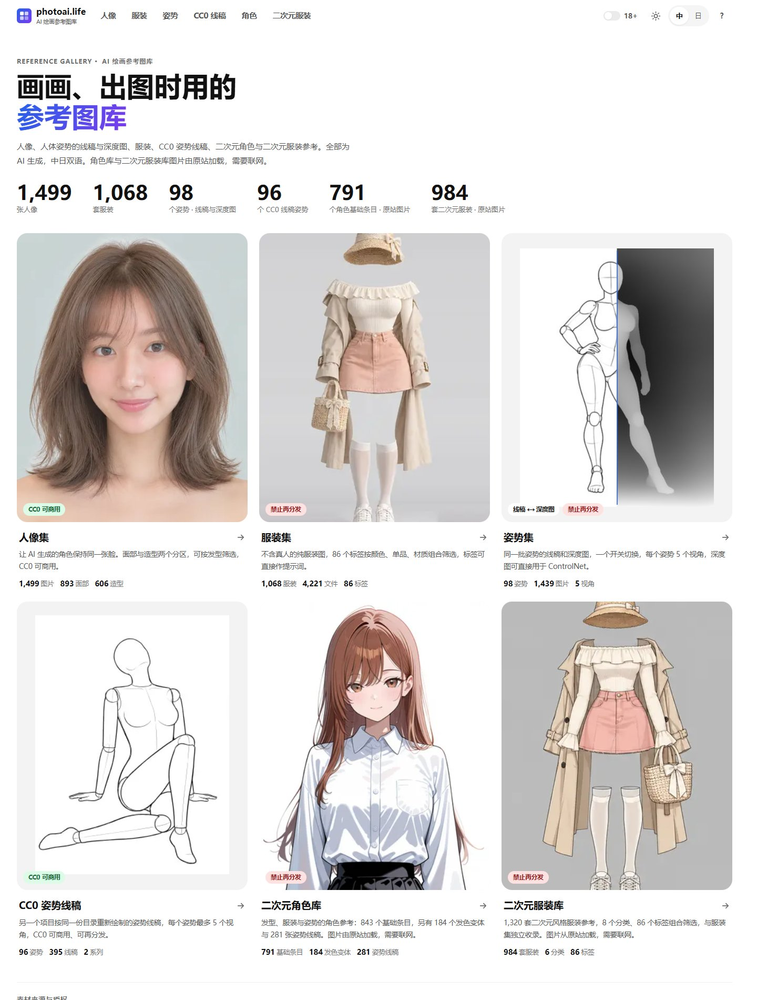

<details>
<summary>📷 All galleries: Portrait, Pose, Depth, Costume, Shisei, Character and Anime Costume</summary>

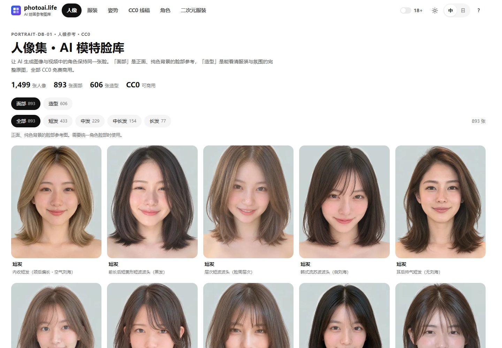

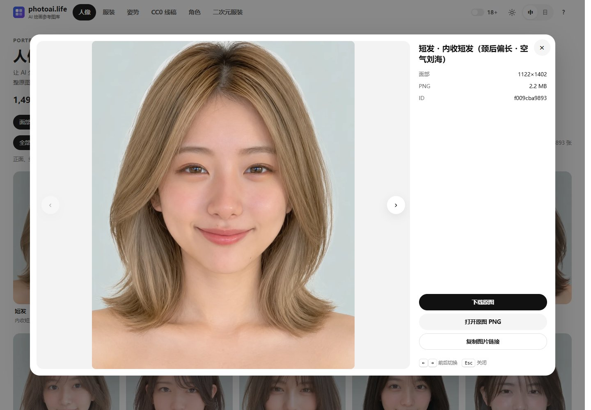

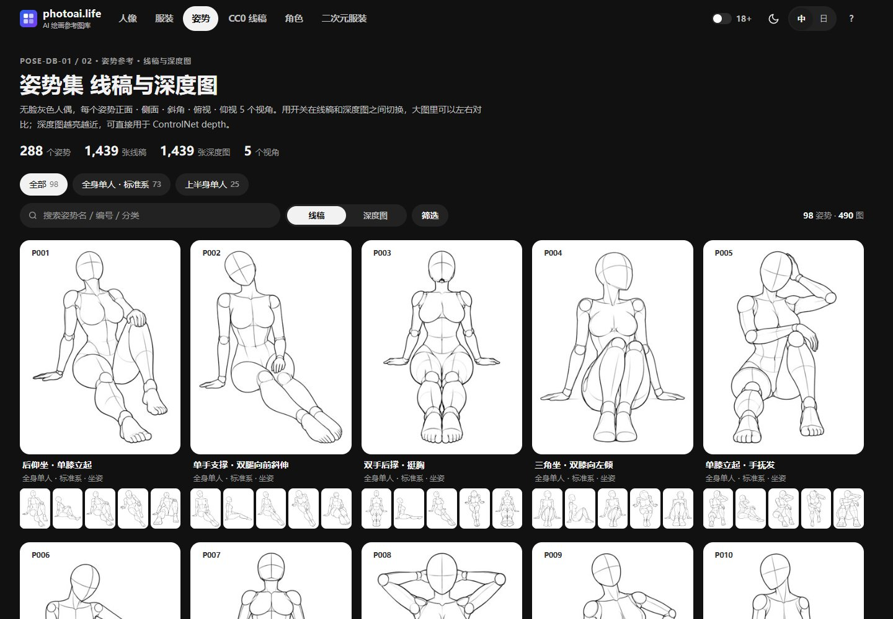

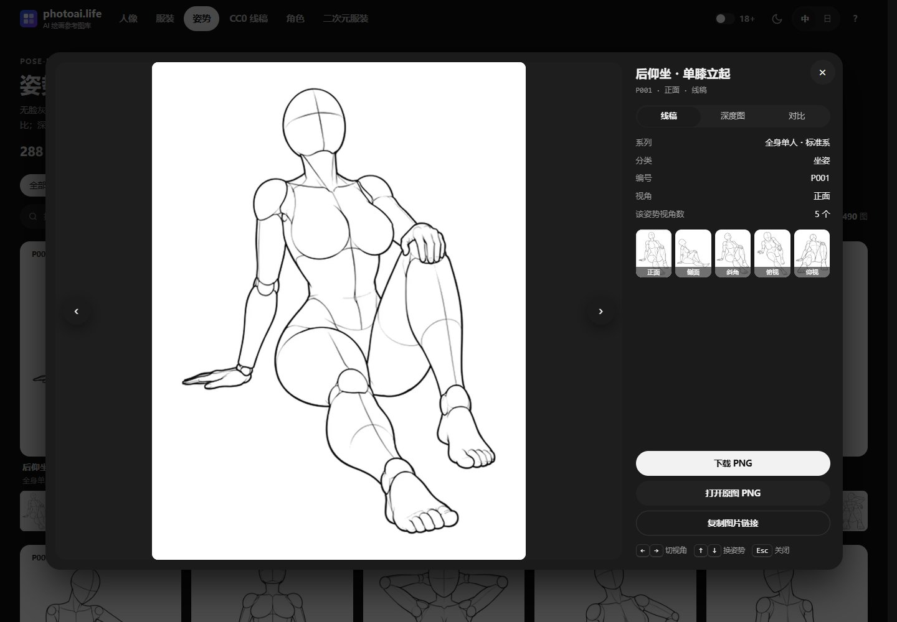

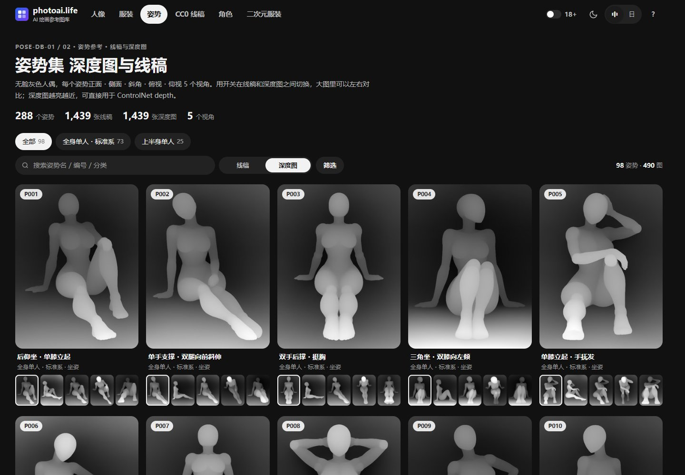

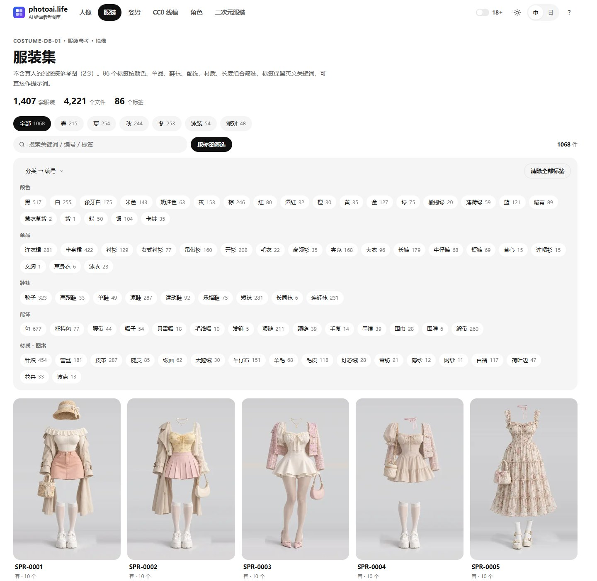

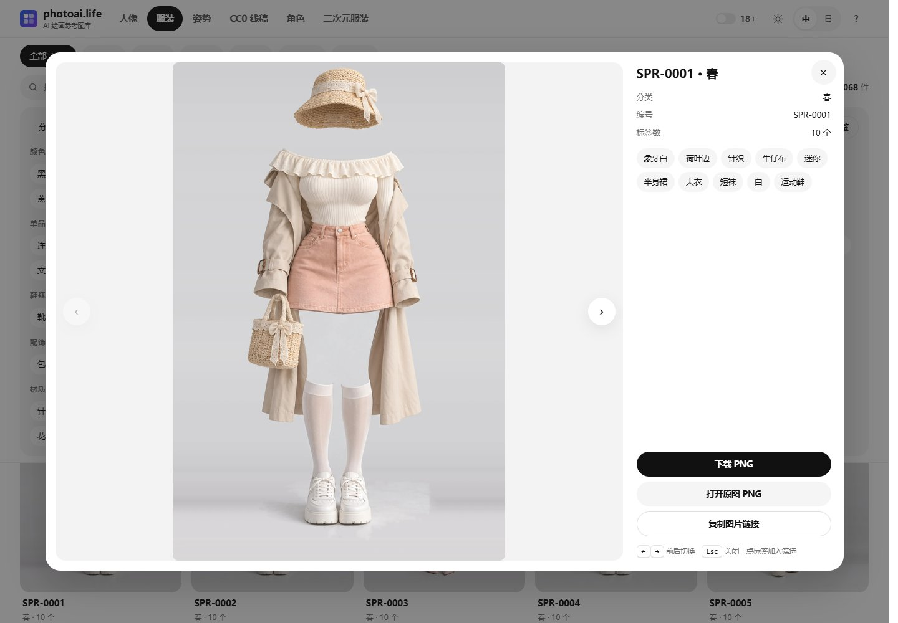

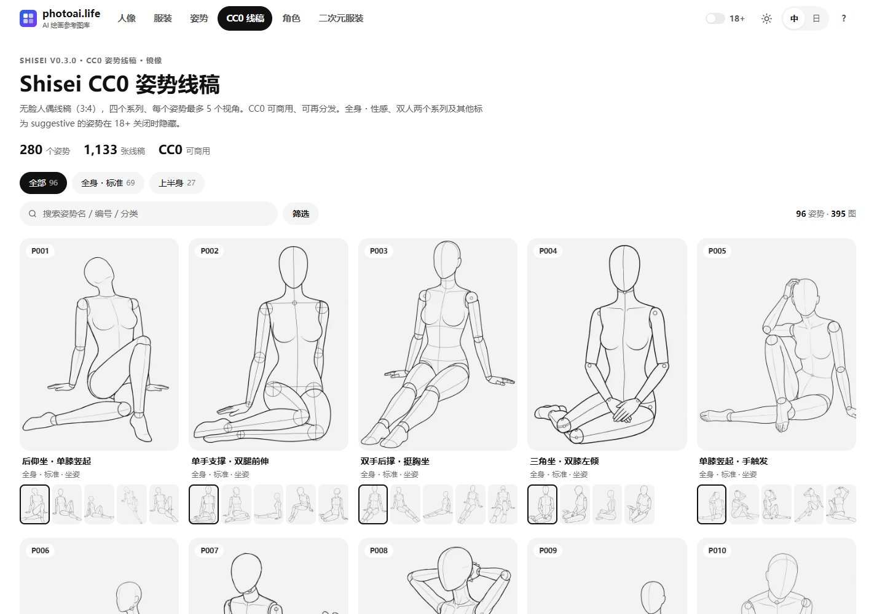

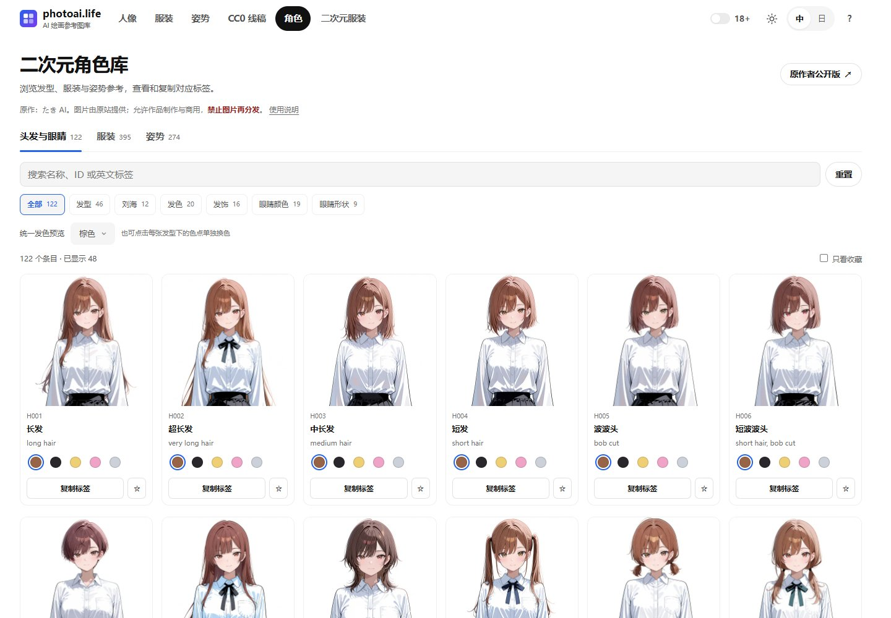

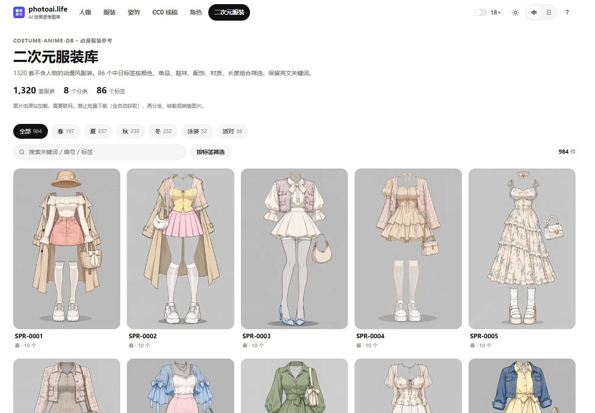

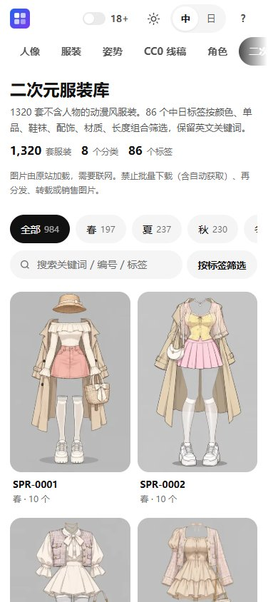

Captured from a local build preview on 2026-11-02 with 18+ disabled and no added blur. These show the UI, not the production deployment status. The artwork belongs to its original authors; do not crop images out of the screenshots for other use. See [screenshot notes](docs/screenshots/README.md) for scope and updates.

</details>

## Sites

| Site | Content | Size | Image license |
| --- | --- | --- | :---: |
| [Portrait](https://photoai.life/portrait/) | Face references for character consistency, filterable by hairstyle | 1,499 | **CC0** |
| [Pose](https://photoai.life/pose/) | Faceless gray mannequin line art, 5 angles per pose | 1,439 | No redistribution |
| [Pose Depth](https://photoai.life/pose-depth/) | Grayscale depth maps of the same poses, for ControlNet | 1,439 | No redistribution |
| [Costume](https://photoai.life/costume/) | Outfits without models, 86 faceted tags | 1,407 items / 4,221 files | No redistribution |
| [Shisei line art](https://photoai.life/shisei/) | Faceless mannequin line art, 4 series, up to 5 angles; adult content hidden by default | 280 poses / 1,133 | **CC0** |
| [Character](https://photoai.life/character/) | Hairstyle, outfit and pose references with per-card color swatches and pose line art | 843 base entries + 184 hair-color variants; 281 pose line drawings | No redistribution of original or processed images |
| [Anime Costume](https://photoai.life/costume-anime/) | Anime-style outfits, 8 categories and 86 faceted tags | 1,320 outfits; 984 visible by default | No bulk downloading or redistribution |

Seven physical sites appear as six galleries in navigation because Pose and Pose Depth share one gallery. Character has 122 hair and eye entries, 440 outfits and 281 poses (843 base entries); including hair-color variants there are 1,027 entries plus 281 pose line drawings. Across all seven manifests there are 21,536 local image files.

Every gallery has batched grids, filters and search, image enlargement, theme and language switches, and local image viewing/downloads (Character opens local full-size JPEGs and pose line art; `Esc` closes its detail view). A shared top bar holds the gallery links and the 18+, light / dark and language switches; preferences apply across all galleries. Press `?` for shortcuts and `/` to jump to search. Pose has one switch between line art and depth maps, and the lightbox can compare both with a draggable divider. Adult-oriented items are hidden by default on Pose, Pose Depth, both Costume galleries, Shisei and Character (Character initially offers 791 base entries, with 184 hair-color variants available through previews); the 18+ switch in the top bar shows them after a one-time age check, shared across all sites. They never appear on static landing pages or in the sitemap. Each page is a single `index.html` with embedded data and no framework, CDN or web fonts.

> **Portrait and Shisei images are CC0.** The other sites forbid redistribution. Character allows commercial artwork, reference use and modifications, but forbids redistributing original or processed images and using them to represent real people or minors. Shisei's pose list follows ai-pose-gallery and is credited only. See `sites/<id>/NOTICE.md`.

### Character gallery

This is a resource library, with no image-generation service, API-key settings or multi-part tag assembly. Character uses square white image areas and provides:

- Hair and eyes, outfits, and poses, with visible category buttons and counts; adult-only categories are marked 18+ while hidden.
- Five color swatches on each hairstyle card, independent of other cards. Detail color changes update the card; the global color menu resets previews and Reset returns to brown.
- Exact single-entry English tag copying and browser-local favorites that store the displayed variant. Preview changes do not rewrite saved favorites.
- Offline metadata, search, categories and tag copying, plus offline local images once fetched via `tools/fetch.py` (never committed to Git).

See [Character notes](sites/character/README.md) for usage and catalog maintenance, and [source terms](sites/character/NOTICE.md) for image conditions.

### Anime Costume gallery

A separate source catalog with 1,320 outfits, 8 categories and 86 translated tags. It is separate from the existing 1,407-item Costume gallery even where IDs overlap. Lingerie and sexy categories are hidden until age confirmation and excluded from all static landing pages. Local deployments fetch thumbnails, previews and full PNGs via `tools/fetch.py` into gitignored directories.

The [public standalone repository](https://github.com/Brilliant666/ai-costume-anime-gallery-cn) remains an image-free index snapshot with source-hosted image links and links back to photoai.life. See [source terms](sites/costume-anime/NOTICE.md) and [export instructions](docs/COSTUME_ANIME_STANDALONE.md). Repository updates and production deployment are separate; the live version depends on the deployed release.

## Quick start

This repo does not package gallery image assets; `docs/screenshots/` contains UI demonstrations only. `tools/fetch.py` downloads images for all seven locally hosted sites into gitignored directories (and automatically skips any future site configured with `imageMode: "remote"`). Requires **Python 3.8+**. `tools/mid.py`, which generates lightbox previews, also needs Pillow (`pip install pillow`); every other script uses only the standard library.

```bash
git clone https://github.com/Brilliant666/ai-image-gallery.git
cd ai-image-gallery

python tools/fetch.py      # download all seven galleries locally (~8.5 GB first time, then only missing files)
python tools/mid.py        # generate lightbox previews (~290 MB)
python tools/build.py      # build seven site entries (six galleries) and the hub
python tools/release.py    # assemble dist/ (images are hard links, no extra disk)
python tools/serve.py      # preview at http://127.0.0.1:8080/
```

To try the UI only, run `python tools/fetch.py --tier thumb` to fetch thumbnails (~120 MB).

Check the result through `serve.py`, not by opening `dist/index.html` directly: `file://` differs from `http://` in relative paths, Content-Type and caching.

<details>
<summary>Common commands</summary>

| Command | Purpose |
| --- | --- |
| `python tools/fetch.py --site pose` | Download one site |
| `python tools/mid.py --site portrait` | Generate previews for one site |
| `python tools/verify.py` | Verify all local images and generated previews |
| `python tools/build.py --site character` | Rebuild Character and the hub without image network access |
| `python tools/build.py --site pose` | Rebuild one site |
| `python tools/build.py --base https://x.com` | Set the public domain for canonical / og / sitemap |
| `python tools/release.py --out <dir>` | Release into another directory |
| `python tools/serve.py --root sites/pose` | Preview one site |
| `python tests/run.py` | Checks that need no images: build output up to date, duplicate ids, inline JS syntax, manifests, doc links (CI runs it on every push) |

`release.py` verifies local images first and stops if any are missing (add `--skip-verify` if you fetched only some tiers). It deletes and recreates each target site directory. `--no-images` copies site files only; it does not keep old images in place.

</details>

## Image loading

Locally hosted galleries load images by tier: thumbnails for the grid, previews (or lightweight JPEGs) for the lightbox/detail view, and originals on demand. Character fetches local thumbnails (`thumb/`), full JPEGs (`img/`) and pose line art (`line/`); Anime Costume fetches local thumbnails (`thumbs/`), WebP previews (`img/`) and full PNGs (`png/`).

| Tier | Portrait | Pose | Pose Depth | Costume / Anime Costume | Character |
| --- | ---: | ---: | ---: | ---: | ---: |
| Thumbnail | ~20 KB | ~17 KB | ~11 KB | ~10–15 KB | ~20 KB |
| Preview | ~150 KB | ~33 KB | ~10 KB | ~80–90 KB | — |
| Original | ~3.2 MB | ~450 KB | ~95 KB | ~1–1.2 MB | ~170 KB |

- The lightbox shows the sharp thumbnail at once and fades in the preview when it arrives. Switching images hides the previous one immediately.
- Portrait, Pose, Pose Depth, Costume and Shisei prefetch previews on hover/focus; Anime Costume loads the selected preview on demand and opens full PNGs via link; Character loads ~170 KB local JPEGs directly in detail view and toggles local PNG line art.
- Previews for both Costume galleries and Shisei come from the original sites; Portrait, Pose and Pose Depth previews are generated by `tools/mid.py` (longest edge 1600 px, WebP quality 82). If a preview is missing, the lightbox falls back to the original.

Measured on the Portrait site at 1.5 MB/s and 150 ms latency: a direct click shows the preview after about 0.6 s; after hovering for about 1 s, the preview shows as soon as the lightbox opens.

## Deployment

Point the web root at `dist/`. It is flat (`index.html` + `portrait/` + `pose/` + …), so the hub's relative links work without nginx `alias`.

```bash
# Server update: drops build output; stops and lists any hand-edited files instead of overwriting them
python3 tools/update.py
python3 tools/mid.py
python3 tools/build.py --base https://your-domain
python3 tools/release.py --out dist-stage   # stage first, check, then swap sites into dist/ atomically
```

First-time setup, nginx, atomic swaps and rollback: [deploy/DEPLOY.md](deploy/DEPLOY.md) (Chinese).

## Project layout

```
ai-image-gallery/
├── sites.json          # single manifest: sites, order, licenses, image tiers
├── sites/<id>/         # each site: scripts, data, build output, NOTICE
├── shared/             # download and verify for all sites; page generator, source parser and JA→ZH dictionary for Pose and Pose Depth
├── hub/                # hub page generator (also writes root sitemap / robots)
├── tools/              # fetch / mid / verify / build / release / serve / update
├── deploy/             # deployment guide and nginx template
├── tests/              # checks that need no images (python tests/run.py)
└── docs/               # documentation and screenshots
```

Gallery image assets stay out of git, apart from UI screenshots in the docs: ~8.5 GB of binaries would make every clone huge, and most source terms prohibit bundling images in public repos. `release.py` hard-links 27,046 image files into `dist/`, which costs no extra disk on the same file system.

## Documentation

[Deployment guide](deploy/DEPLOY.md) · [Adding a site](docs/ADDING_A_SITE.md) · [Sharing and SEO](docs/SEO.md) · [Site notes (llms.txt)](https://photoai.life/llms.txt) · [nginx template](deploy/nginx.conf) · Per-site notes: [Portrait](sites/portrait/README.md) · [Pose](sites/pose/README.md) · [Pose Depth](sites/pose-depth/README.md) · [Costume](sites/costume/README.md) · [Shisei](sites/shisei/README.md) · [Character](sites/character/README.md) · [Anime Costume](sites/costume-anime/README.md)

The deployment guide and adding-a-site guide are in Chinese.

## License and credits

| Scope | License |
| --- | --- |
| Code: `tools/`, `hub/`, `shared/`, each site's `scripts/`, and the HTML/CSS/JS in `index.html` | [MIT](LICENSE) |
| Images | Differs per site, see `sites/<id>/NOTICE.md` |
| Independently written Chinese translations in `data/` and the Character name map | CC BY 4.0 |
| Source catalog fields, keywords and images for Character and Anime Costume | Original author terms; not relicensed by this repository. See [Character](sites/character/NOTICE.md) · [Anime Costume](sites/costume-anime/NOTICE.md) |

Images come from the original sites. Portrait by [あぎ](https://x.com/agi_aibusi) ([original](https://ai-portrait-gallery.pages.dev/)); Pose, Pose Depth, Costume and Anime Costume by [ギア](https://x.com/giaaibusi) ([pose](https://ai-pose-gallery.pages.dev/) · [pose depth](https://ai-pose-depth-gallery.pages.dev/) · [costume](https://ai-costume-gallery.pages.dev/) · [anime costume](https://ai-costume-anime-gallery.pages.dev/)). Shisei line art comes from [wquguru/shisei](https://github.com/wquguru/shisei) (CC0). Character comes from [たき AI](https://x.com/taki_auto)'s [キャラ組み立てDB](https://charadb-2fi.pages.dev/). This project is a personal Chinese-language index for learning.
