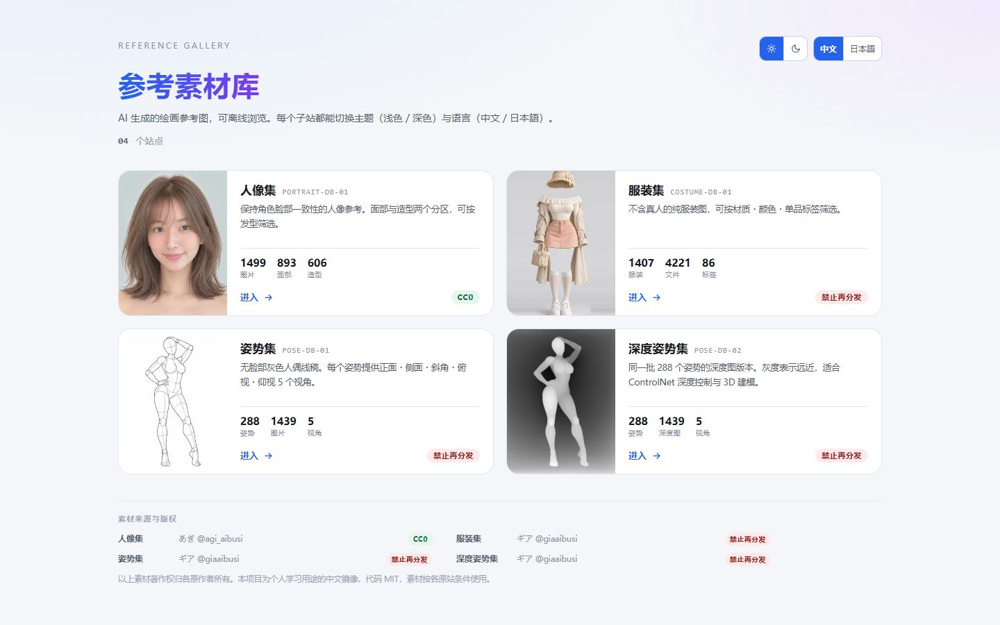
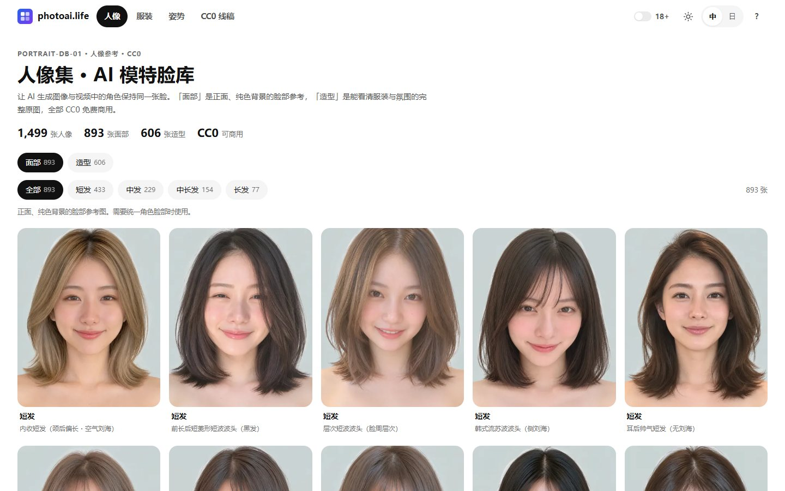
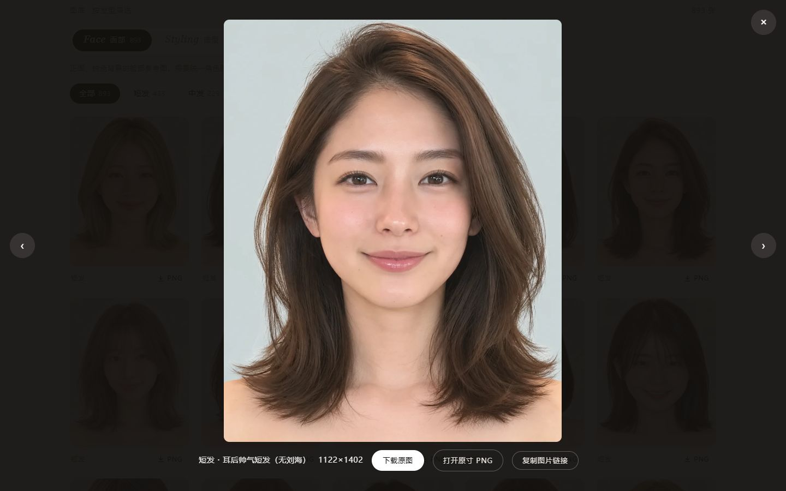
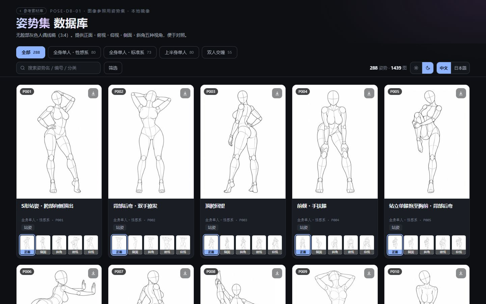
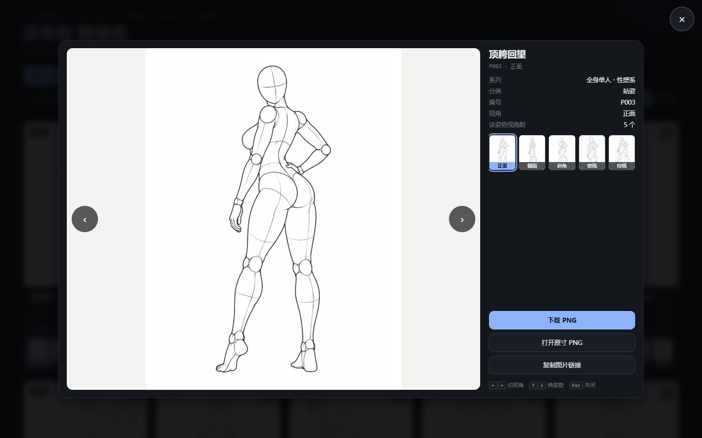
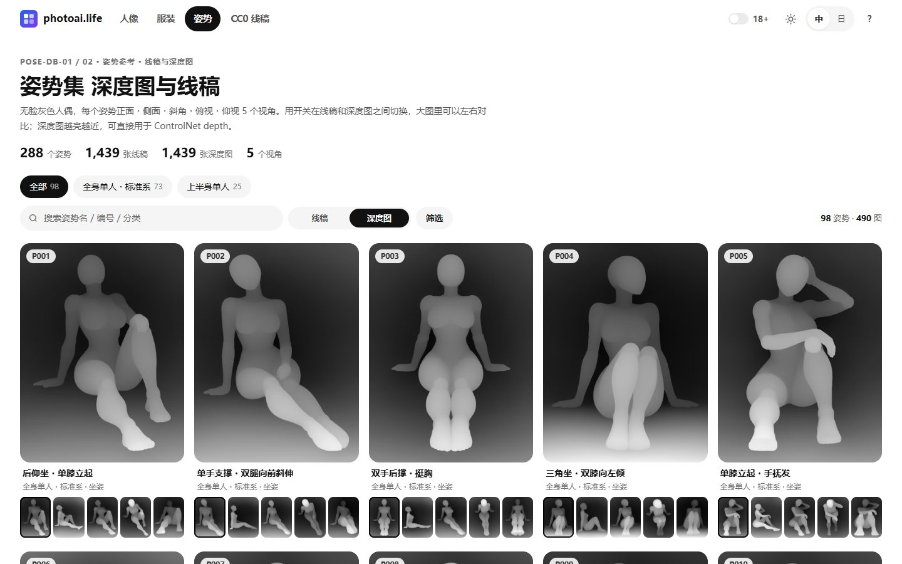
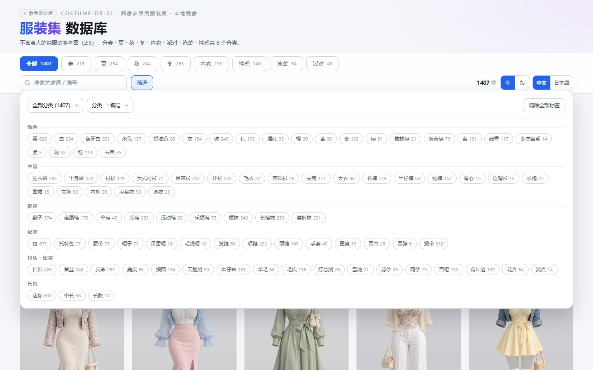
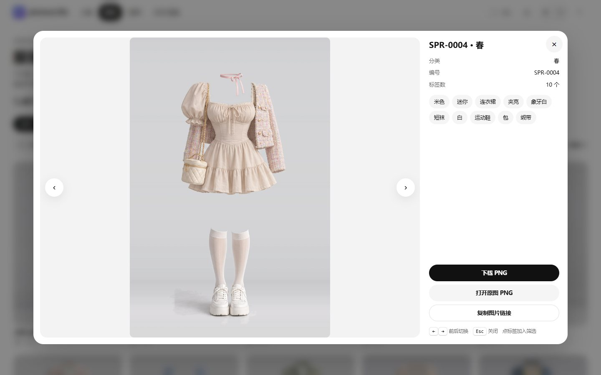

<div align="center">

# AI 参照画像ライブラリ

**AI イラスト向けの参照画像ギャラリー 5 つ、1 リポジトリでビルド、1 ディレクトリで公開**

ポートレート · ポーズ · デプス ポーズ · 衣装 · CC0 ポーズ線画 · 15,241 枚 · 中国語 / 日本語 · ライト / ダーク

[](https://github.com/Brilliant666/ai-image-gallery/actions/workflows/ci.yml)
[](https://photoai.life/)
[](#サイト)
[](#サイト)
[](#クイックスタート)
[](#ライセンスとクレジット)

### [オンラインで見る · photoai.life →](https://photoai.life/)

[简体中文](README.md) · [English](README_en.md) · **日本語**

[サイト](#サイト) · [クイックスタート](#クイックスタート) · [画像の読み込み](#画像の読み込み) · [デプロイ](#デプロイ) · [ドキュメント](#ドキュメント)

</div>



<details>
<summary>📷 その他のスクリーンショット：ポートレート・ポーズ・デプス・衣装</summary>















スクリーンショットは UI 説明のため公開サイトから撮影したものです。素材の著作権は各原作者に帰属します。スクリーンショットから素材を切り出して利用しないでください。

</details>

## サイト

| サイト | 内容 | 規模 | 素材ライセンス |
| --- | --- | --- | :---: |
| [ポートレート集](https://photoai.life/portrait/) | キャラクターの顔の一貫性のための参考、髪型で絞り込み | 1,499 枚 | **CC0** |
| [ポーズ集](https://photoai.life/pose/) | 顔なしグレーマネキンの線画、1 ポーズ 5 アングル | 1,439 枚 | 再配布禁止 |
| [デプス ポーズ集](https://photoai.life/pose-depth/) | 同じポーズの深度マップ、ControlNet 向け | 1,439 枚 | 再配布禁止 |
| [衣装集](https://photoai.life/costume/) | 人物なしの衣装、86 タグで絞り込み | 1,407 着 / 4,221 枚 | 再配布禁止 |
| [Shisei 線画](https://photoai.life/shisei/) | 顔なしマネキン線画、4 シリーズ × 5 アングル。suggestive はぼかし表示 | 280 ポーズ / 1,133 枚 | **CC0** |

各サイト共通：ページ送り付きグリッド、絞り込みと検索、ライトボックス（`←` `→` で移動、`Esc` で閉じる、タッチでスワイプ）、原寸ダウンロード、テーマと言語の切り替え。ページ上部の共通バーにギャラリー切り替え・18+・ライト / ダーク・言語をまとめ、設定は全ギャラリー共通です。右上の ⓘ メニューから使い方（`/guide/`）、注意事項とライセンス、GitHub リポジトリ、フィードバックへ移動できます。ショートカット：`1`–`4` でギャラリー切り替え、`0` でトップページ、`?` で一覧、`/` で検索欄へ移動します。「レシピ」ではギャラリーをまたいでポートレート・衣装・ポーズを 1 つずつ選び、英語／中国語のプロンプト（複数画像参照またはテキストのみ、スタイル指定可）や 3 枚並びの参考ボードを作れます。レシピはブラウザ内にのみ保存され、成人向けの内容は追加できません。ポーズ集はスイッチ一つで線画と深度マップを切り替え、拡大表示では仕切りをドラッグして左右に比較できます。ポーズ集・深度ポーズ集・衣装集の成人向け内容は初期状態で非表示、Shisei はぼかし表示です。上部バーの「18+」で年齢を一度確認すると表示され、5 サイト共通で記憶します。成人向け内容は静的ランディングページと sitemap には載りません。ページは単一の `index.html` でデータを内蔵し、フレームワーク・CDN・Web フォントを使いません。

> **CC0 はポートレート集と Shisei です。** 他の 3 サイトの素材は再配布禁止です。Shisei のポーズ目録は ai-pose-gallery に基づき出典表記のみです。詳しくは `sites/<id>/NOTICE.md` を参照してください。

## クイックスタート

このリポジトリに画像ファイルは含まれていません。`tools/fetch.py` が各元サイトから取得します。**Python 3.8+** が必要です。ライトボックス用の中サイズ画像を作る `tools/mid.py` だけは Pillow（`pip install pillow`）も必要で、他のスクリプトは標準ライブラリのみで動きます。

```bash
git clone https://github.com/Brilliant666/ai-image-gallery.git
cd ai-image-gallery

python tools/fetch.py      # 全画像をダウンロード（初回約 6.8 GB、以降は不足分のみ）
python tools/mid.py        # ライトボックス用の中サイズ画像を生成（約 290 MB）
python tools/build.py      # 5 サイトとトップをビルド
python tools/release.py    # dist/ を組み立て（画像はハードリンク、容量は増えない）
python tools/serve.py      # http://127.0.0.1:8080/ でプレビュー
```

見た目だけ確認したい場合は `python tools/fetch.py --tier thumb` でサムネイルのみ取得できます（約 90 MB）。

確認は `serve.py` で行ってください。`dist/index.html` を直接開くと、相対パス・Content-Type・キャッシュの挙動が `http://` と異なります。

<details>
<summary>よく使うコマンド</summary>

| コマンド | 用途 |
| --- | --- |
| `python tools/fetch.py --site pose` | 1 サイトだけダウンロード |
| `python tools/mid.py --site portrait` | 1 サイトだけ中サイズ画像を生成 |
| `python tools/verify.py` | 画像を検証：存在・サイズ・寸法・中サイズの有無 |
| `python tools/build.py --site pose` | 1 サイトだけ再ビルド |
| `python tools/build.py --base https://x.com` | 公開ドメインを canonical / og / sitemap に反映 |
| `python tools/release.py --out <dir>` | 別のディレクトリへリリース |
| `python tools/serve.py --root sites/pose` | 1 サイトだけプレビュー |
| `python tests/run.py` | 画像不要のチェック：ビルド成果物の更新漏れ、重複 id、インライン JS 構文、manifest、文書リンク（CI が push ごとに実行） |

`release.py` は先に画像を検証し、欠けていれば中止します（一部の段階だけ取得した場合は `--skip-verify`）。対象サイトのディレクトリは削除してから作り直します。`--no-images` はサイトファイルのみをコピーするもので、既存の画像を残す用途には使えません。

</details>

## 画像の読み込み

画像は 3 段階あります。グリッドはサムネイル、ライトボックスは中サイズ、原寸はダウンロード時のみ使います。

| 段階 | ポートレート | ポーズ | デプス | 衣装 |
| --- | ---: | ---: | ---: | ---: |
| サムネイル | 約 20 KB | 約 17 KB | 約 11 KB | 約 10 KB |
| 中サイズ | 約 150 KB | 約 33 KB | 約 10 KB | 約 90 KB |
| 原寸 | 約 3.2 MB | 約 450 KB | 約 95 KB | 約 1 MB |

- ライトボックスは鮮明なサムネイルをすぐ表示し、中サイズが届いたらフェードインします。画像を切り替えると前の画像はすぐ消えます。
- カードに 120 ms ホバー、タップ開始、キーボードフォーカスで中サイズを先読みします。開いた後は前後の画像も先読みします。
- 衣装集の中サイズは元サイトのものです。他の 3 サイトは `tools/mid.py` が原寸から生成します（長辺 1600 px、WebP 品質 82）。中サイズがない場合は原寸を読み込みます。

ポートレート集を 1.5 MB/s・遅延 150 ms で計測：直接クリックすると約 0.6 秒で中サイズに切り替わります。約 1 秒ホバーしてからクリックすると、開いた時点で中サイズが表示されます。

## デプロイ

Web ルートを `dist/` に向けます。`dist/` はフラット構成（`index.html` + `portrait/` + `pose/` + …）なので、nginx の `alias` は不要です。

```bash
# サーバー更新：ビルド成果物は破棄、手で変更したファイルがあれば中止して一覧表示
python3 tools/update.py
python3 tools/mid.py
python3 tools/build.py --base https://あなたのドメイン
python3 tools/release.py --out dist-stage   # まず一時ディレクトリへ。確認後にサイト単位で dist/ と入れ替え
```

初回構築・nginx・アトミックな入れ替え・ロールバックは [deploy/DEPLOY.md](deploy/DEPLOY.md)（中国語）を参照してください。

## 構成

```
ai-image-gallery/
├── sites.json          # 唯一の一覧：サイト、順序、ライセンス、画像の段階
├── sites/<id>/         # 各サイト：スクリプト、データ、ビルド成果物、NOTICE
├── shared/             # 全サイト共通のダウンロードと検証、ポーズ / デプス共用のページ生成器・元サイト解析・日中辞書
├── hub/                # トップページ生成器（ルートの sitemap / robots も出力）
├── tools/              # fetch / mid / verify / build / release / serve / update
├── deploy/             # デプロイ手順と nginx テンプレート
├── tests/              # 画像不要のチェック（python tests/run.py）
└── docs/               # ドキュメントとスクリーンショット
```

画像は git に入れません。6.8 GB のバイナリは clone のたびに重く、多くのサイトのライセンスでも認められていません。`release.py` は 20,751 個の画像ファイルを `dist/` にハードリンクするため、同じファイルシステム上なら容量は増えません。

## ドキュメント

[デプロイ手順](deploy/DEPLOY.md) · [サイトの追加](docs/ADDING_A_SITE.md) · [nginx テンプレート](deploy/nginx.conf) · 各サイト：[ポートレート](sites/portrait/README.md) · [ポーズ](sites/pose/README.md) · [デプス ポーズ](sites/pose-depth/README.md) · [衣装](sites/costume/README.md) · [Shisei](sites/shisei/README.md)

デプロイ手順とサイト追加ガイドは中国語です。

## ライセンスとクレジット

| 範囲 | ライセンス |
| --- | --- |
| コード：`tools/`、`hub/`、`shared/`、各サイトの `scripts/`、`index.html` 内の HTML/CSS/JS | [MIT](LICENSE) |
| 画像素材 | サイトごとに異なる。`sites/<id>/NOTICE.md` を参照 |
| `data/` の中国語訳 | CC BY 4.0 |

素材は各元サイトによるものです。ポートレート集：[あぎ](https://x.com/agi_aibusi)（[元サイト](https://ai-portrait-gallery.pages.dev/)）。ポーズ集・デプス ポーズ集・衣装集：[ギア](https://x.com/giaaibusi)（[ポーズ](https://ai-pose-gallery.pages.dev/) · [デプス](https://ai-pose-depth-gallery.pages.dev/) · [衣装](https://ai-costume-gallery.pages.dev/)）。Shisei の線画は [wquguru/shisei](https://github.com/wquguru/shisei)（CC0）より。本プロジェクトは個人学習目的の中国語ミラーです。
